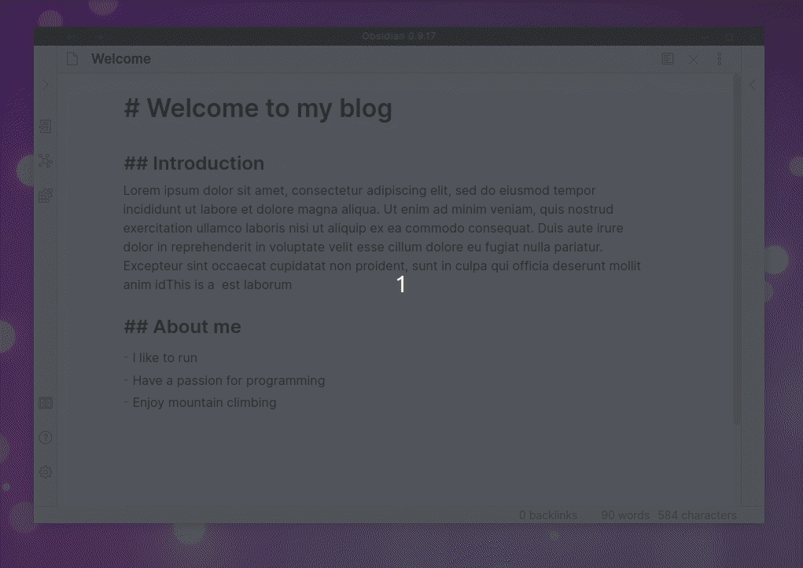

# Emoji Toolbar - Obsidian Plugin

This plugin for [Obsidian](https://obsidian.md/) allows you to quickly search for and add emojis to your editor.

## Usage

After enabling the plugin, you'll find a new hot key setting called `Emoji Toolbar: Open emoji picker`. Set this to whatever you like. Once clicked it will allow you to search through a list of emojis.

Start typing a word to filter through the list. You can insert the emoji into the editor by either clicking on it, or use the arrow keys and then press enter to insert the emoji.

## Features

- Skin Tone Support
- Fuzzy / Semantic Search Matches
- Select Recently Used Emoji
- Twitter emoji formatting for preview and insert modal for improved emoji support. This can be toggled on/off in the Emoji Toolbar settings tab.

## Install

### Within Obsidian

1. Click Settings | Third Party Plugins
2. Ensure that Safe mode is turned off
3. Click on Community plugins "Browse"
4. Look for Emoji

## Network use

By default, Emoji Toolbar makes no network requests; the emoji picker and its data are bundled with the plugin.

If you enable **Twitter Emoji** in the plugin settings, emoji images are loaded from the [jsDelivr](https://www.jsdelivr.com/) CDN (`cdn.jsdelivr.net`) in both the picker and reading view. The only information sent is the standard request metadata (such as your IP address) that comes with any image request. No note content, vault data or telemetry is sent. Turning the setting off stops these requests.

# Thanks

- A big thanks to liamcain for producing the [obsidian-react-starter](https://github.com/obsidian-community/obsidian-react-starter
) which the basis of v0.3.0+ is made from
- Also to [Emoji Mart](https://github.com/missive/emoji-mart
)